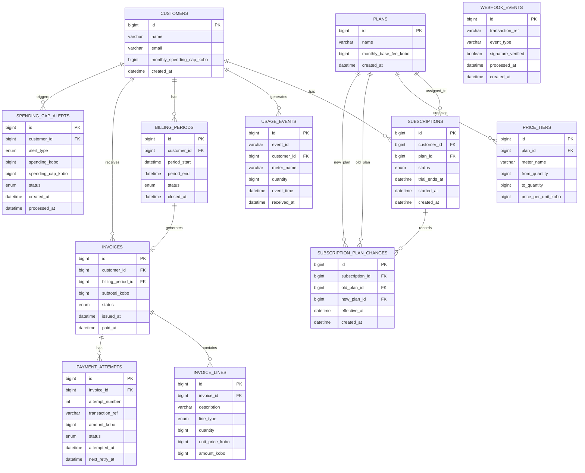

# TokenMeter – Entity Relationship Diagram (ERD)

This diagram represents the database structure of the TokenMeter usage-based billing system.

It contains 12 tables showing the primary keys (PK), foreign keys (FK), and relationships between the entities.

## Database Relationships

## Key

- PK – Primary Key
- FK – Foreign Key

## Database Information

- Database: MySQL
- Database name: tokenmeter_db
- Total tables: 12
- Currency storage: Integer kobo
- Datetime storage: UTC
